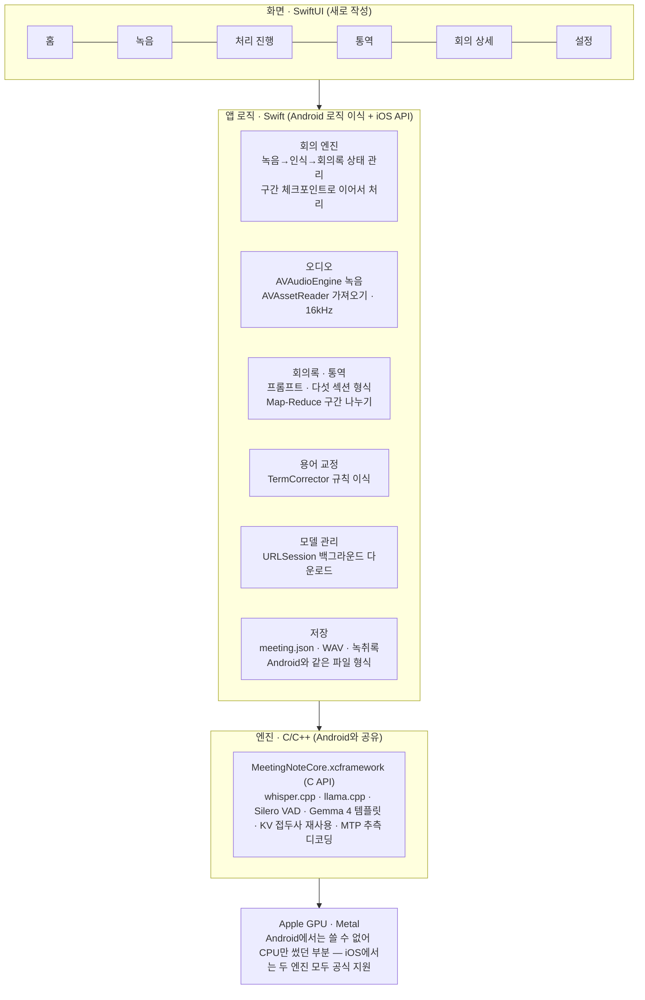

# 회의노트 iOS 버전 설계안

2026-11-27 작성 · 원본: [claude.ai 문서](https://claude.ai/artifact/MYmGFzMBsoPzMhnhf1XCBi)

## 요약

iOS 버전은 만들 수 있습니다. **SwiftUI 네이티브 앱 + whisper.cpp·llama.cpp(Metal GPU)를 쓰는 공유 C/C++ 엔진** 구성을 권장합니다. Android에서는 GPU를 쓸 수 없어 CPU만 썼지만, Apple GPU는 두 엔진 모두 공식 지원합니다. 그래서 회의록 작성 속도는 오히려 Android 태블릿보다 빠를 가능성이 큽니다.

- **대상 기기**: RAM 8GB 이상 — iPhone 15 Pro 이후, M1 이후 iPad. iOS 17 이상.
- **가장 큰 차이**: 녹음이 끝난 뒤 화면을 끈 채 회의록을 쓰는 것은 iOS에서 보장되지 않습니다. 처리 중에는 앱을 켜 두는 흐름으로 바꿉니다.
- **작업량(대략)**: 1인 + Claude Code 기준 약 8~11주. 필요한 것은 Mac(Xcode), Apple Developer Program(연 $99), 테스트용 iPhone 또는 iPad입니다.
- **재사용**: 엔진 C/C++ 코드, 프롬프트, 회의록 형식, 모델 파일, 개인정보처리방침은 그대로 씁니다. 화면, 녹음, 파일 처리, 백그라운드 처리는 새로 만듭니다.

## 무엇을 재사용하고 무엇을 새로 만드나

엔진과 회의록 로직의 핵심은 가져가고, Android 전용 API에 묶인 부분은 새로 만듭니다.

| 현재 Android 구성 | iOS에서 | 비고 |
| --- | --- | --- |
| whisper.cpp / llama.cpp (서브모듈) | 그대로 사용 | Metal을 켜서 빌드, XCFramework로 포장 |
| JNI 래퍼 (빅코어 고정, KV 접두사 재사용, Gemma 4 템플릿, MTP 추측 디코딩) | C++ 부분 재사용, JNI만 제거 | 빅코어 고정은 iOS에서 불필요(운영체제가 관리) |
| 회의록·통역 프롬프트, 다섯 섹션 형식, Map-Reduce 구간 나누기 (Summarizer, Translator) | Swift로 옮김 | 문자열·규칙은 그대로, 코드만 번역 |
| 용어 교정 (TermCorrector), 발화 단위 나누기, 음량 보정 | Swift로 옮김 | 순수 로직이라 단위 테스트도 옮김 |
| 모델 목록·다운로드 (ModelCatalog, DownloadManager) | 새로 (URLSession 백그라운드 다운로드) | 같은 Hugging Face 주소·파일 |
| 녹음 (AudioRecord), 파일 가져오기 (MediaCodec) | 새로 (AVAudioEngine, AVAssetReader) | 16kHz 모노 변환 |
| 포그라운드 서비스 + wake lock (MeetingService) | 새로, 방식 변경 | 아래 'iOS 제약' 참고 |
| Jetpack Compose 화면 (홈, 녹음, 상세, 설정, 통역, 기기 점검) | 새로 (SwiftUI) | 화면 구성·문구는 그대로 |
| 저장 (meeting.json, WAV, transcript.json) | 같은 형식으로 새로 구현 | 파일 형식이 같으면 나중에 기기 간 이동도 가능 |
| 기기 점검 (DeviceCheck) | 단순화 | 지원 기기가 한정돼 점검 항목이 줄어듦 |
| 오류 보고 (GitHub 이슈 열기) | 그대로 옮김 | |

## 접근 방식 비교

SwiftUI 네이티브를 권장합니다. 녹음 세션, 백그라운드 처리, Metal 같은 핵심 부분은 어차피 iOS 전용 코드입니다. 그래서 Kotlin 코드 중 공유할 수 있는 양이 생각보다 적습니다.

| 항목 | A. SwiftUI 네이티브 (권장) | B. Kotlin/Compose Multiplatform |
| --- | --- | --- |
| 공유되는 코드 | C/C++ 엔진만 | 엔진 + 프롬프트·용어 교정·저장 로직(Kotlin) |
| 기존 Android 앱 영향 | 없음 | 모듈 구조를 나눠야 함 (리팩터링 + 회귀 위험) |
| iOS 화면 품질 | iOS 표준 느낌, 접근성·다이나믹 타입 기본 지원 | Compose 느낌, iOS 관례와 어긋날 수 있음 |
| 녹음·백그라운드·Metal | 직접 호출 | 어차피 iOS 쪽 코드(expect/actual)로 따로 작성 |
| 기능 추가 시 | 두 곳에 구현 | 한 곳 (UI까지 공유할 때) |
| 처음 출시까지 | 빠름 | 느림 (구조 전환 기간 추가) |

두 플랫폼에 기능을 자주 함께 추가할 계획이라면 B도 검토할 만합니다. 다만 지금은 Android 앱을 안정화하는 단계입니다. 우선 A로 출시하고, 프롬프트·규칙 파일만 공유하는 수준에서 시작하는 편이 위험이 적습니다.

## iOS 아키텍처

엔진층은 Android와 같은 C/C++ 코드를 XCFramework로 묶어 씁니다. 그 위의 두 층(화면, 앱 로직)만 Swift로 새로 만듭니다.

- **빌드**: whisper.cpp와 llama.cpp를 GGML_METAL=ON으로 빌드합니다. 현재 `native-common`의 C++ 래퍼를 C 함수로 노출해 iOS(기기·시뮬레이터)용 XCFramework로 포장합니다.
- **스레드**: 추론은 전용 작업 스레드 하나에서 돌리고, 화면은 Swift Concurrency(@MainActor)로 상태만 받습니다. Android의 '전용 추론 스레드' 구조와 같습니다.
- **저장**: 회의별 폴더에 meeting.json, audio.wav, transcript.json을 Android와 같은 형식으로 둡니다. 녹음은 30초마다 저장합니다. 비정상 종료 뒤 WAV를 복구하는 로직도 옮깁니다.

## iOS 제약과 대응

설계를 바꿔야 하는 제약은 백그라운드 처리와 메모리 두 가지입니다.

| 제약 | Android 현재 | iOS 대응 |
| --- | --- | --- |
| 녹음 중 화면 끄기 | 포그라운드 서비스(microphone) | 가능. Background Modes의 audio를 켜고 AVAudioSession이 활성 상태이면 녹음이 계속됨 |
| 녹음 중 실시간 인식·통역 (화면 꺼짐) | 가능 | 녹음 중에는 앱이 살아 있어 가능. 다만 백그라운드에서는 GPU 사용이 제한될 수 있어 CPU로 바꿔야 할 수 있음 (실측 필요) |
| 녹음 종료 후 정밀 인식·회의록 작성 (수 분~수십 분) | dataSync 포그라운드 서비스로 화면이 꺼져도 계속 | 보장 안 됨. 처리 화면에서 화면 꺼짐을 막고(isIdleTimerDisabled) 진행률을 표시. 앱을 나가면 일시정지했다가 돌아오면 이어서 처리(구간 단위 체크포인트). iOS 26의 BGContinuedProcessingTask를 쓸 수 있는 기기는 이를 이용한 백그라운드 연장 검토 |
| 알림에서 녹음 종료 | 알림 버튼 | Live Activity(잠금 화면·Dynamic Island)에 녹음 시간과 종료 버튼 |
| 메모리 | largeHeap, RAM 4GB 이상 허용 | 앱별 한도가 엄격(넘으면 즉시 종료). increased-memory-limit 권한 사용, 대상을 RAM 8GB 기기로 제한, Whisper를 해제한 뒤 Gemma를 올리는 현재 순차 방식 유지, 모델은 mmap으로 읽기 |
| 모델 다운로드 (약 4GB) | DownloadManager | URLSession 백그라운드 세션(앱을 나가도 이어서 받음). 파일은 Application Support에 두고 iCloud 백업 제외로 표시 |
| 발열·스로틀링 | 빅코어 4개 고정 | ProcessInfo.thermalState를 보고 serious 이상이면 처리를 늦추거나 안내 |
| 파일 가져오기 | 공유·파일 선택 | 파일 앱 선택(fileImporter) + 공유 시트 확장 |

## 대상 기기와 예상 성능

첫 버전은 RAM 8GB 이상 기기로 제한합니다. 모델은 Android와 똑같이 쓰고, 메모리에는 한 번에 하나씩 올립니다.

| 대상 | 기기 | 비고 |
| --- | --- | --- |
| 지원 | iPhone 15 Pro / Pro Max, iPhone 16 이후 전 모델, iPad (M1 이후, iPad mini A17 Pro) | RAM 8GB 이상 |
| 미지원 (1차) | iPhone 15 / 15 Plus 이하 (RAM 6GB) | Gemma를 쓰면 메모리 초과로 종료될 위험. 필요하면 나중에 녹취 전용 모드로 확장 |

| 모델 | 파일 크기 | 용도 |
| --- | --- | --- |
| Whisper small q8_0 | 264MB | 실시간 인식·통역 |
| Whisper large-v3-turbo q8_0 | 874MB | 회의 후 정밀 인식 |
| Gemma 4 E2B Q4_0 + MTP 초안 모델 | 2.84GB + 59MB | 회의록·통역 |
| Silero VAD | 0.9MB | 무음 구간 제거 |

성능은 아직 실측값이 없습니다. 두 엔진 모두 Apple GPU(Metal)를 공식 지원하므로, CPU만 쓰는 Snapdragon 870 태블릿보다 빠를 것으로 예상합니다(태블릿에서 정밀 인식은 녹음 시간의 약 0.66배). 1단계에서 테스트 기기로 벤치마크를 먼저 돌려 확인합니다.

## 화면 구성

Android 화면을 그대로 옮기고, iOS에서만 되는 잠금 화면 표시와 처리 중 화면 흐름을 더합니다. iPad에서는 NavigationSplitView로 목록과 상세를 나란히 보여 줍니다(Android 태블릿 2단 화면과 같은 역할).

| Android 화면 | iOS 화면 | 달라지는 점 |
| --- | --- | --- |
| 홈 (날짜별 목록, 검색, 상태 배지) | HomeView (List + searchable) | 없음 |
| 녹음 화면 (큰 타이머, 파형) | RecordView | Live Activity로 잠금 화면·Dynamic Island에 녹음 시간과 종료 버튼 |
| 회의록 작성 진행 (%, 남은 시간, 4단계) | ProcessingView | 화면 꺼짐 방지 + "처리가 끝날 때까지 앱을 켜 두세요" 안내, 끝나면 로컬 알림 |
| 실시간 통역 (큰 자막) | InterpretView | 없음 |
| 회의 상세 (회의록·녹취록 편집·공유) | DetailView | 공유는 ShareLink |
| 설정 (모델 받기·삭제, 용어 사전, 저장 공간, 정보) | SettingsView (Form) | CPU 스레드 설정 제거 |
| 기기 점검 | 첫 실행 때 간단히 확인 | 지원 기기가 정해져 있어 속도 측정은 선택 항목으로 |
| (없음) | 첫 실행 안내 | 모델 4GB 다운로드 동의 + Wi-Fi 권장 + 마이크 권한 설명 |

## App Store 등록 요건

Play에서 준비한 자료(개인정보처리방침, 스토어 문구, 아이콘)는 대부분 그대로 씁니다. iOS에서 새로 챙길 것은 아래와 같습니다.

- **계정**: Apple Developer Program 개인 가입(연 $99). TestFlight로 내부 테스터 최대 100명, 외부 테스터 최대 10,000명까지 테스트할 수 있습니다. Play의 '12명·14일' 비공개 테스트 요건 같은 것은 없습니다.
- **개인정보 라벨(App Privacy)**: "데이터를 수집하지 않음". Play 데이터 보안과 같은 근거입니다.
- **개인정보 매니페스트(PrivacyInfo.xcprivacy)**: 필수. 파일 타임스탬프·디스크 공간·UserDefaults 같은 'required reason API'를 쓰는 이유를 적습니다.
- **권한 문구**: NSMicrophoneUsageDescription("회의를 녹음해 기기 안에서 회의록을 만듭니다. 녹음은 외부로 전송되지 않습니다.").
- **수출 규정**: HTTPS 외에는 암호화를 쓰지 않으므로 ITSAppUsesNonExemptEncryption = NO.
- **심사 포인트**
    - 첫 실행에 4GB를 받는 것 자체는 허용됩니다. 심사자가 바로 확인할 수 있도록 심사 메모에 다운로드 시간과 절차를 적습니다.
    - 모델을 받기 전에도 빈 화면이 나오지 않도록 안내 화면과 다운로드 진행률을 보여 줍니다(최소 기능 기준, 가이드라인 4.2).
    - Background Modes의 audio는 녹음할 때만 씁니다. 녹음하지 않을 때 앱을 살려 두는 용도로 쓰면 거절 사유가 됩니다(2.5.4).
    - 생성형 AI 결과에 대해 Play와 마찬가지로 '결과 신고' 수단을 두면 안전합니다.
- **기기 제한**: App Store에는 RAM 기준 제한 설정이 따로 없습니다. increased-memory-limit을 선언하고, 지원하지 않는 기기에서는 앱 안에서 안내한 뒤 녹취 기능만 제공하거나 사용을 막습니다.

## 단계별 작업 계획

1단계 엔진 검증에서 메모리·백그라운드 제약을 확인하면, 나머지는 Android에서 검증된 흐름을 옮기는 일입니다. 총 약 8~11주(1인 + Claude Code, 대략 추정)입니다.

| 단계 | 기간 | 내용 | 다음 단계로 가는 조건 |
| --- | --- | --- | --- |
| 1. 엔진 검증 | 2주 | whisper.cpp·llama.cpp Metal 빌드와 XCFramework 포장 · 테스트 기기에서 속도·메모리·발열 벤치마크 · 화면이 꺼졌을 때와 백그라운드에서 추론이 어디까지 되는지 확인 | 8GB 기기에서 Gemma·turbo가 메모리 초과 없이 동작 |
| 2. 핵심 흐름 | 3~4주 | 모델 다운로드, 녹음(백그라운드 오디오), 회의 후 정밀 인식 · 회의록 작성(프롬프트·Map-Reduce 이식), 저장·복구 · 홈·녹음·처리 진행·상세 화면 | 31분짜리 실제 회의를 녹음부터 회의록까지 처리 |
| 3. 기능 맞추기 | 2~3주 | 실시간 통역, 파일 가져오기, 용어 사전·교정 · 회의록 편집·공유, 설정, 자동 제목, 검색 · Live Activity, iPad 2단 화면 | 같은 회의로 Android와 결과를 비교하고 기능 목록이 일치 |
| 4. 출시 준비 | 1~2주 | 개인정보 매니페스트, App Privacy 라벨, 스크린샷 · TestFlight 테스트, 심사 메모 작성 · App Store 심사 제출 | — |

기간은 실측 없이 잡은 대략치이며, 1단계가 끝나면 벤치마크 결과로 다시 잡습니다. 모든 단계는 Mac에서 Xcode와 Claude Code로 진행해야 합니다. 지금의 Linux 환경에서는 iOS 빌드를 할 수 없습니다.

## 위험 요소와 열린 질문

가장 큰 위험은 백그라운드 처리 제약이며, 1단계 벤치마크에서 먼저 확인합니다.

| 위험 | 영향 | 대응 |
| --- | --- | --- |
| 화면이 꺼진 상태에서 Metal 사용이 제한될 수 있음 | 녹음 중 실시간 인식·통역이 느려짐 | CPU 대체 경로 유지, 녹음 중에는 녹음만 하고 회의 후 인식(현재 기본값과 같음) |
| 앱을 나가면 회의록 작성이 멈춤 | 사용자 불편 | 구간 단위 체크포인트로 이어서 처리, 끝나면 알림 |
| 메모리 초과로 종료됨 (jetsam) | 처리 중 앱 종료 | 모델 순차 로드, 컨텍스트 길이 제한, os_proc_available_memory()로 로드 전 확인 |
| 오래 처리할 때 발열 | 속도 저하 | thermalState 감시, 필요하면 일시 중단 |
| 두 플랫폼 기능 차이 | 유지보수 부담 | 프롬프트·용어 교정 규칙을 공유 파일로 분리 |

열린 질문

- [ ] 테스트용 iPhone/iPad는 어떤 기기가 있나요? (RAM 8GB 이상 필요)
- [ ] iPhone과 iPad 중 어느 쪽을 먼저 지원할까요?
- [ ] Apple Developer Program에 개인과 조직 중 어느 쪽으로 가입할까요?
- [ ] RAM 6GB iPhone 사용자에게 녹취 전용 모드를 제공할까요?
- [ ] 앱 이름과 번들 ID(예: com.meetingnote.app)를 Android와 맞출까요?
